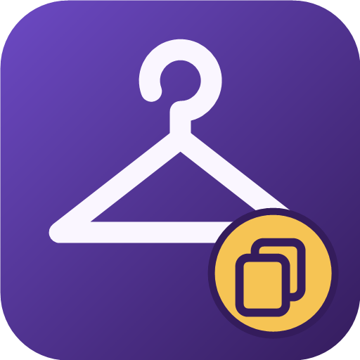

# Copy Glamour



A Dalamud plugin for FFXIV. Copy a glamour page from [Eorzea Collection](https://ffxiv.eorzeacollection.com/), and it puts the gear and dyes on your character through [Glamourer](https://github.com/Ottermandias/Glamourer), which you need installed. It also shows where to get each piece.

## Install

1. In game, type `/xlsettings` and open the **Experimental** tab.
2. Under **Custom Plugin Repositories**, paste this URL, tick the box, and click Save:
   ```
   https://raw.githubusercontent.com/aryvector/CopyGlamour/main/repo.json
   ```
3. Type `/xlplugins`, search for **Copy Glamour**, and install it.

Dalamud checks for a new version every time the game starts and updates the plugin for you.

## Use

1. Open a glamour page on Eorzea Collection in your browser.
2. Press Ctrl+A, then Ctrl+C.
3. Type `/copyglamour` in game. While the window is open, it loads the copied page on its own. You can also click **Paste from clipboard**.
4. Untick any pieces you don't want, then click **Apply selected**.

You can also save the page with Ctrl+S and paste the file's path into the window, or type `/copyglamour C:\path\to\page.html`.

Pasting the page's link won't work, because Eorzea Collection blocks downloads that don't come from a browser.

### The window

- **Apply selected** puts the ticked pieces on you as a temporary Glamourer change. Each row says whether Glamourer accepted the piece.
- **Revert** undoes all Glamourer changes on your character, including appearance changes.
- **Save as Glamourer design…** asks for a name and saves what you're wearing right now as a new design, so apply the glamour first. **Open saved design in Glamourer** then opens it.
- **Where to get** lists gil vendors, currency and Grand Company vendors, and crafting recipes. **Map** puts a flag on the vendor and **Recipe** opens the crafting log. **Look up** opens the item on Garland Tools, Teamcraft or the Console Games Wiki, which list everything else, such as duty drops, quests and Mog Station items.
- Click an item's name to copy it for the market board or the armoire search. Under the name, a line says where you already have the piece: equipped, inventory, armoury chest, saddlebag, glamour dresser (outfit sets too), armoire, a retainer, or unlocked for facewear.
- **Options** holds the auto-load setting and loading a page saved with Ctrl+S.
- **Recent glamours** keeps the last 20 glamours you loaded.

The game only knows what's in the dresser, the armoire and a retainer while you have it open. The plugin saves their contents each time you open one, and uses that copy after you close it, so open each once. Until then the window lists them as not checked yet. The saddlebag loads the first time you open it in a session.

Weapons only apply for a job that can use them. If Glamourer refuses one, the row names the job to switch to.

Facewear works too. The plugin takes its colour from the page's first dye.

## Build

Needs the .NET 10 SDK and XIVLauncher with Dalamud installed.

```sh
dotnet build -c Release
dotnet run --project Tests
```

The build puts `latest.zip` in `bin/Release/CopyGlamour/`. `Tests` checks the page reader against sample pages. To test a real page, save it as `Tests/Fixtures/<name>.html` and copy it into `Tests/Fixtures/<name>.txt`. The checks then compare both readings.

## Release

1. Raise `<Version>` in `CopyGlamour.csproj`.
2. Commit, then tag and push: `git tag v1.0.0.0 && git push origin main --tags`.

The release workflow builds the plugin, runs the checks, publishes `latest.zip` and updates `repo.json`. Players get the update the next time they start the game.

## Credits

Matching shops to the NPCs that sell them follows [GlamourBrowser](https://github.com/ShyneeAK/GlamourBrowser) by ShyneeAK (MIT).
